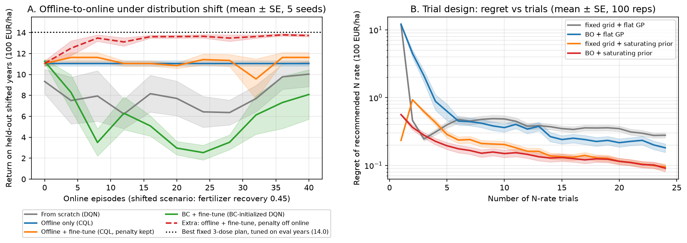

# Offline-to-online crop management agent + knowledge-guided trial design (simulation-only proof of concept)

A reinforcement-learning agent in a crop simulator

**All results come from a crop simulator (PCSE LINTUL3, spring wheat, Dutch weather 1976–1999).**



## What it does

**Part A: offline-to-online nitrogen management.** Weekly N-dose decisions (12 weeks, doses 0–10 g N/m², where 1 g N/m² = 10 kg N/ha). Reward = value of yield − cost of N, in units of 100 EUR/ha. With yield Y and N dose in g/m² (1 g/m² = 10 kg/ha), R = 0.02·Y − 0.10·N, which assumes 0.20 EUR/kg for yield and 1.00 EUR/kg for N (placeholder prices; "yield" is the simulator's storage-organ dry weight, WSO). Part B uses the same constants as Part A.
1. *Historical trials:* a noisy calendar rule (about 16 g N/m² in two doses, lognormal dose error, ±1 week timing jitter, 15% random actions) run over 14 weather years (1976–1989), 30 trials per year.
2. *Offline learning:* behavior cloning (`DiscreteBC`) and conservative Q-learning (`DiscreteCQL`, d3rlpy 2.8.1, PyTorch).
3. *Distribution shift:* a **simulator parameter change** that lowers fertilizer recovery from 0.7 to 0.45 (a stand-in for lower fertilizer-use efficiency, such as leaching). The best total N rises from about 16 to about 24 g N/m², outside most of the historical data. The recovery fraction is **hidden** from the agent: its 7-variable observation (week, development stage, leaf area, soil mineral N, nitrogen nutrition index, total N applied so far, water-stress factor) only reflects it indirectly, through how soil N and NNI respond to doses. Online episodes use weather years 1992–1995; evaluation uses held-out years 1996–1999 under the same shift.
4. *Online fine-tuning:* 40 episodes, epsilon-greedy exploration (0.3 → 0.05 over 20 episodes), 100 gradient updates per episode, each batch half offline and half online data.
5. *Variants:* from scratch (DQN, no offline data); offline only (CQL); offline then fine-tune (CQL); BC then fine-tune (BC weights copied into a DQN, then fine-tuned). One extra ablation is marked below.

**Part B: knowledge-guided trial design.** A trial is one season at a random weather year with a single N rate applied; the observation is simulated yield plus Gaussian plot noise (SD 30 g/m²). Goal: recommend the N rate with the best expected net return (averaged over weather years). We compare a 2×2: design {one-factor fixed N-rate grid, Bayesian optimization with a simplified acquisition rule} × model {flat GP, human-specified saturating prior}. The models estimate the **yield** response to N; recommendations convert predicted yield to net return with the assumed prices. The BO acquisition rule is an **independent-marginal Thompson-sampling heuristic**: it samples a posterior value independently at each candidate N rate and picks the best, ignoring correlations between rates. It is not conventional GP Thompson sampling, and it is untuned. The prior encodes "yield increases with N and saturates": yield = b0 + A(1 − exp(−N/τ)), with a prior over τ. The Gaussian prior on A favors positive values but does not enforce positivity. Regret = best achievable expected net return minus that of the recommended rate. All methods see identical weather-year and noise sequences within a repetition (common random numbers), and the models are given a noise SD of 70.6 g/m² that includes year-to-year weather variability. That value is calibrated from the simulator's own year-to-year variability; in a real trial series it would have to be estimated from historical data or pilot trials. The 100 repetitions are independent simulated trial campaigns (different sampled weather years and plot noise), not 100 different simulator calibrations.

## Results (5 seeds for Part A, 100 repetitions for Part B; mean ± standard error)

**Part A, return on held-out shifted years after 40 online episodes** (best fixed 3-dose plan under the shift, found by searching on the evaluation years themselves, so it is an optimistic benchmark: 14.0):

| Variant | Start | After 40 episodes | Range across seeds |
|---|---|---|---|
| From scratch (DQN) | 9.3 | 10.0 ± 1.2 | 6.0–12.7 |
| Offline only (CQL) | 11.0 | 11.0 ± 0.3 | 10.4–11.5 |
| Offline + fine-tune (CQL) | 11.0 | 11.6 ± 0.5 | 10.4–13.3 |
| BC + fine-tune | 11.3 | 8.1 ± 2.4 | 2.2–13.2 |
| *Extra:* offline + fine-tune, CQL penalty switched off online | 11.0 | **13.7 ± 0.1** | 13.4–14.0 |

Plain reading:
- The four variants requested do **not** show a clean win for offline-to-online learning. Offline CQL starts better than scratch DQN, but CQL fine-tuning with its penalty kept adds little.
- BC + fine-tune is unstable and often collapses to applying no N. The BC-to-Q weight copy is a heuristic, not a standard BC-pretrained actor-critic, so this may reflect the implementation and not the idea.
- The extra variant, which sets CQL's penalty weight to 0 during online learning, reaches the ceiling within about 8 episodes. I added it **after** seeing the flat result, with one setting and no experiment isolating why it works. It is consistent with the penalty discouraging larger doses under the shift, but this explanation is a hypothesis.
- Scratch DQN is very noisy over 40 episodes, so its mean is uncertain.

**Part B, regret of the recommended N rate (100 EUR/ha; true best rate 16 g N/m², net return 14.3):**

| Method | 6 trials | 12 trials | 24 trials |
|---|---|---|---|
| Fixed grid + flat GP | 0.48 | 0.38 | 0.28 ± 0.02 |
| BO + flat GP | 0.45 | 0.34 | 0.18 ± 0.03 |
| Fixed grid + saturating prior | 0.24 | 0.16 | 0.095 ± 0.010 |
| BO + saturating prior | 0.18 | 0.15 | 0.091 ± 0.010 |

- The saturating prior is the clear win: regret at 24 trials is about 2.9× lower with the grid and 2.0× lower with BO.
- With the flat GP, BO beats the grid at 24 trials. With the prior, BO and the grid are statistically indistinguishable (paired difference at 24 trials −0.004 ± 0.014; BO is nominally ahead at 6 trials, −0.061 ± 0.031, about 2 SE, which I read as suggestive, not established).
- **An earlier version of this analysis was wrong in two ways:** the models assumed 30 g/m² noise while the data also contained weather variability, and BO and the grid did not share random numbers. With those fixed, the earlier finding that the grid beats BO under the prior disappeared. The old overconfident setting is kept in `run_partB_sensitivity.py` for comparison.
- Sensitivity (`results/partB_sensitivity.json`): with offset grid levels, the prior still gives 0.10 regret at 24 trials versus 0.16–0.46 for the flat GP.
- The BO acquisition rule (Thompson sampling on independent marginals) is untuned, so this says little about BO in general. The true curve is not exactly the assumed exponential form, so the prior is misspecified and still helps.

## Reproduce

```bash
make install     # PyTorch 2.8.0 CPU wheel first, then pinned requirements
make test        # 10 tests, about 30 s
make all         # tests, reference plans, Part A (5 seeds), Part B (+ sensitivity), plots
# or: make docker
```

## Limitations

- Simulation only. LINTUL3 has no N losses (leaching, volatilization), so splitting a dose gives no benefit; the weekly-control problem is easier than a real field.
- In-distribution, an oracle N rate per year beats the best single fixed rate by only about 1.2%, so the setup is informative mainly under the recovery shift I chose. The shift design and its size are my choices and drive the conclusions.
- The reference plan (best fixed 3-dose plan in weeks 1–3) is tuned on the evaluation years and is not a globally optimal policy.
- Hyperparameters (CQL penalty weight 0.3, learning rates, update counts) came from a small single-seed sweep on in-distribution years, not a systematic search.
- Evaluation uses only four weather years; the shifted years come from the same 24-year Dutch record as training. Years 1990 and 1991 are excluded because the bundled weather files have gaps. Five seeds is small, and error bars are standard errors over seeds.
- Discrete doses with a 12-week horizon; no continuous actions (d3rlpy's IQL is continuous-only, so I used discrete CQL).
- Part B uses one factor (N rate), one crop, and one simulator. Its response comes from one early application at a random weather year, with assumed plot noise. The models use a single pooled noise SD, though the true year-to-year SD grows from about 15 g/m² at N=0 to about 70 g/m² at N≥24. The prior's family and its τ range are my choices.
- The simulator integration calls PCSE's private `Engine._send_signal`, which works with the pinned `pcse==6.0.13` and may break on other versions.
- d3rlpy pulls in the unmaintained `gym` package and prints a deprecation warning.
